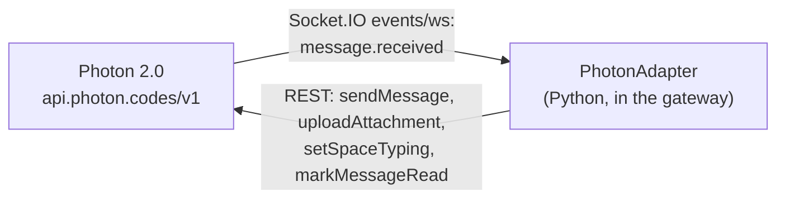

# Photon iMessage platform plugin

This plugin connects Hermes Agent to iMessage through [Photon][photon] 2.0, a managed service
that handles iMessage line allocation, delivery and abuse prevention, so nobody has to run their
own Mac relay.

The free tier uses Photon's shared iMessage line pool and is the path we recommend for everyone
who doesn't already pay for a dedicated number.

## Architecture

Like Discord and Slack, Photon is a **persistent-connection** channel: no public URL, no webhook,
no signing secret. Both directions run in the gateway's Python process, from the `photon` extra
(Photon's `photonhq-api` client and `python-socketio`), which installs on first use.



- **Inbound**: the adapter opens the project's Socket.IO event stream
  (`/v1/projects/{id}/events/ws`, authenticated with the project API key) and subscribes from
  the last event it handled. Deliveries are handled one at a time, in order, and the cursor is
  saved after each one (`<hermes-home>/photon_events.json`), so a dropped connection or a gateway
  restart replays what was missed instead of losing it. Message ids are deduplicated across the
  replay. Reconnects back off up to 60 s.
- **Outbound**: replies, images, typing indicators and read receipts are REST calls through the
  SDK. Every send carries an idempotency key, so the SDK's own retries never double-send.
- **Failures**: before it opens the stream, and again when a reconnect is refused, the adapter
  checks the key against the project. A key Photon rejects (401, 403 or 404) stops the adapter
  with a "run `hermes photon setup`" error instead of retrying forever; network errors and 5xx
  keep retrying.

## First-time setup

```bash
# One-shot setup: device login (only when needed) + project + API key + iMessage line
hermes photon setup --phone +15551234567

# Start the gateway
hermes gateway start
```

Hermes runs on Photon 2.0 (`https://api.photon.codes/v1`). No account yet? Create one at
[app.beta.photon.codes][beta]. `hermes photon setup` does, in order:

1. **Project and API key.** When `PHOTON_PROJECT_ID` and `PHOTON_API_KEY` are already set and
   Photon accepts the key, setup reuses them and never opens a browser. Otherwise it signs you in
   with Photon's device login (RFC 8628: open `https://auth.photon.codes/device` on any device
   and enter the code), finds or creates the `Hermes Agent` project in your organization, and
   mints a project API key. A refused key is replaced and the previous Hermes key revoked.
2. **Assign a shared iMessage line** to your phone number (idempotent; reuses an existing
   assignment) and print the number you text to reach your agent.
3. **Wait for your first text.** A shared line can only reply to, or start a conversation
   with, a number that has texted it. On a terminal, setup waits up to five minutes for that
   message; otherwise `hermes photon status` shows when routing goes live.
4. **Enable the platform** in `config.yaml` and allowlist your number.

**No browser at all:** create a project API key in the dashboard and set the two variables in
`~/.hermes/.env` (or the process environment) before running setup, or instead of it:

```bash
PHOTON_PROJECT_ID=pho_prj_...
PHOTON_API_KEY=pho_sk_...
```

Setup then only needs the account for steps the key cannot do, such as taking a seat when the
key lacks `platforms:write`. The device login works headless too: it prints a URL and a code
to open on any other device.

**Coming from Photon Spectrum** (the platform before Photon 2.0, with `PHOTON_PROJECT_SECRET`):
create a Photon 2.0 account and run `hermes photon setup`. Setup moves the Spectrum
credentials out of `.env` into `auth.json` (`credential_pool.photon_legacy`), where
Photon's coming migration tool can pick them up, and connects a new Photon 2.0 project.

Re-running `setup` resumes where it left off. Run `hermes photon status` to see what's
configured.

## Credentials

Runtime credentials live in `~/.hermes/.env` (the same place every other channel keeps its
token), and the adapter reads them from the environment:

```bash
PHOTON_PROJECT_ID=pho_prj_...   # Photon 2.0 project id
PHOTON_API_KEY=pho_sk_...       # project API key (shown once, when it is created)
```

Management metadata lives in `~/.hermes/auth.json` under `credential_pool`. No API key is
stored there:

```jsonc
{
  "credential_pool": {
    "photon": [          // device-login session, used by setup only (the refresh token rotates)
      { "access_token": "...", "refresh_token": "...", "expires_at": 0, "email": "you@example.com" }
    ],
    "photon_project": [
      { "project_id": "pho_prj_...", "organization_id": "pho_org_...", "api_key_id": "...", "name": "Hermes Agent" }
    ],
    "photon_user": [
      { "phone_number": "+15551234567", "assigned_phone_number": "+1628...", "assigned_at": "..." }
    ],
    "photon_legacy": [   // only after moving off Photon Spectrum
      { "spectrum_project_id": "...", "project_secret": "..." }
    ]
  }
}
```

## Conversations and targets

Photon 2.0 identifies a conversation by its space id (`pho_spc_...`), and that is the chat id
Hermes sessions use. Senders are identified by phone number (E.164), which is what
`PHOTON_ALLOWED_USERS` and pairing hold.

A send target (`PHOTON_HOME_CHANNEL`, `hermes send`, a cron `deliver`) is either a space id or the
phone number of someone who has texted the line. For a number, Hermes looks up that person's
conversation in the line's newest 500 received messages and remembers it. A shared line can't
start a conversation with a number that has never texted it (Photon policy), so such a send fails
at once with that reason rather than being retried.

Standalone senders (cron subprocesses, `hermes send`, the dashboard) call Photon's REST API
directly with the same two credentials, so they work whether or not the gateway is running.

## Configuration knobs

All env vars are documented in `plugin.yaml`. The most important:

| Env var                   | Default                    | Meaning                              |
|---------------------------|----------------------------|--------------------------------------|
| `PHOTON_PROJECT_ID`       | from .env (set by setup)   | Photon 2.0 project id (`pho_prj_...`)|
| `PHOTON_API_KEY`          | from .env (set by setup)   | Project API key (`pho_sk_...`)       |
| `PHOTON_API_HOST`         | https://api.photon.codes   | Photon API host                      |
| `PHOTON_HOME_CHANNEL`     | your number (set by setup) | Default target for cron delivery: a space id, or the E.164 number of someone who has texted the line |
| `PHOTON_ALLOWED_USERS`    | your number (set by setup) | Comma-separated E.164 allowlist      |
| `PHOTON_READ_RECEIPTS`    | true                       | Mark inbound messages read once Hermes has them |
| `PHOTON_MARKDOWN`         | true                       | Send replies as markdown; `false` strips formatting to plain text |
| `PHOTON_REQUIRE_MENTION`  | false                      | Gate group chats on a wake word      |
| `PHOTON_MENTION_PATTERNS` | Hermes wake words          | Wake-word regexes for group chats    |

## What Photon 2.0 iMessage supports

- **Text both ways.** Replies go out as markdown; when Photon refuses a reply's markdown
  (`INVALID_CONTENT`), Hermes resends it once as plain text. `PHOTON_MARKDOWN=false` always sends
  plain text.
- **Images both ways.** Inbound images, files and voice notes are downloaded into the shared
  media cache (up to 64 MB each), so the agent sees the real image or can transcribe the voice
  note. Larger attachments, and downloads that fail, reach the agent as a text marker
  (`[Photon attachment received: …]`). Outbound, images are uploaded and sent natively, with an
  optional caption. Photon 2.0 does not send other files, video or voice notes over iMessage yet,
  so those fall back to the gateway's "can't attach" notice.
- **Threaded replies.** A user's reply to one of Hermes's messages reaches the agent with the
  quoted text.
- **Typing indicator and read receipts.** `PHOTON_READ_RECEIPTS=false` keeps messages at
  `Delivered`.
- **Direct conversations only on a shared line.** A shared line only sends in 1:1 conversations,
  and only to people who have texted it since their line assignment, so group chats get no
  replies there. Mention gating (`require_mention`) still filters group messages before they
  reach the agent.
- **Not available on Photon 2.0 yet:** tapbacks (reactions), polls and message effects. Hermes
  doesn't offer them to the agent on this channel.

## Moving from Photon Spectrum

A Hermes set up before Photon 2.0 (`PHOTON_PROJECT_SECRET` in `.env`) no longer connects: the
gateway stops the adapter with a notice to create a Photon 2.0 account and run
`hermes photon setup`. Spectrum chat ids (`any;-;+1555…` GUIDs) don't exist on Photon 2.0, so
existing Photon sessions start fresh. Setup replaces a `PHOTON_HOME_CHANNEL` that still holds a
GUID with your number; set it by hand to a phone number or a space id otherwise.

[photon]: https://photon.codes/
[beta]: https://app.beta.photon.codes/
